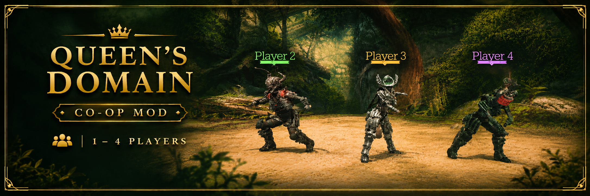
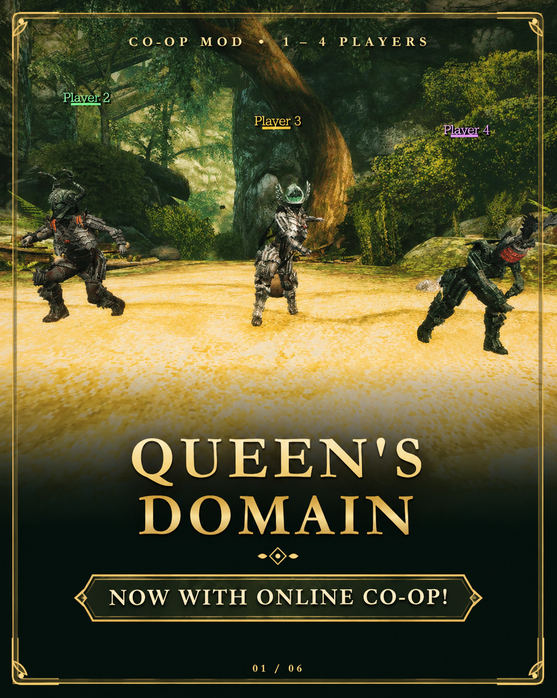
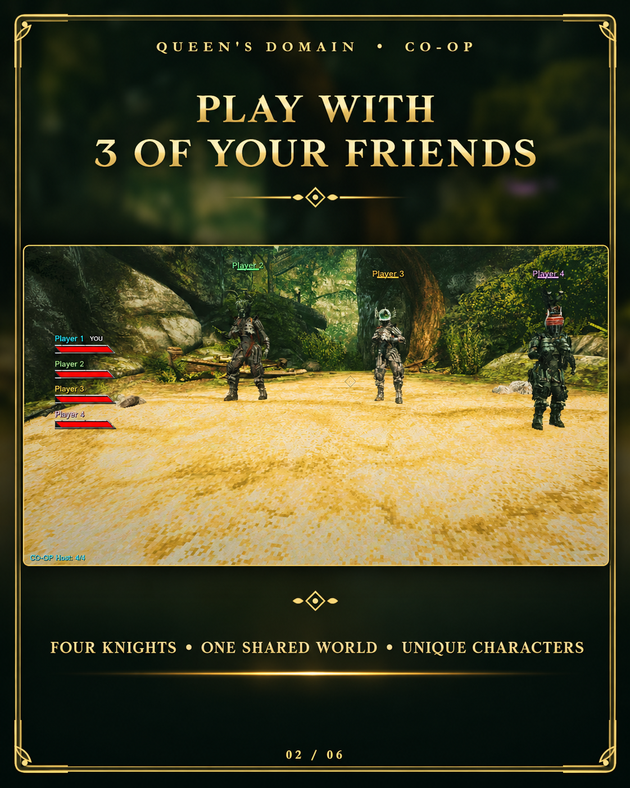
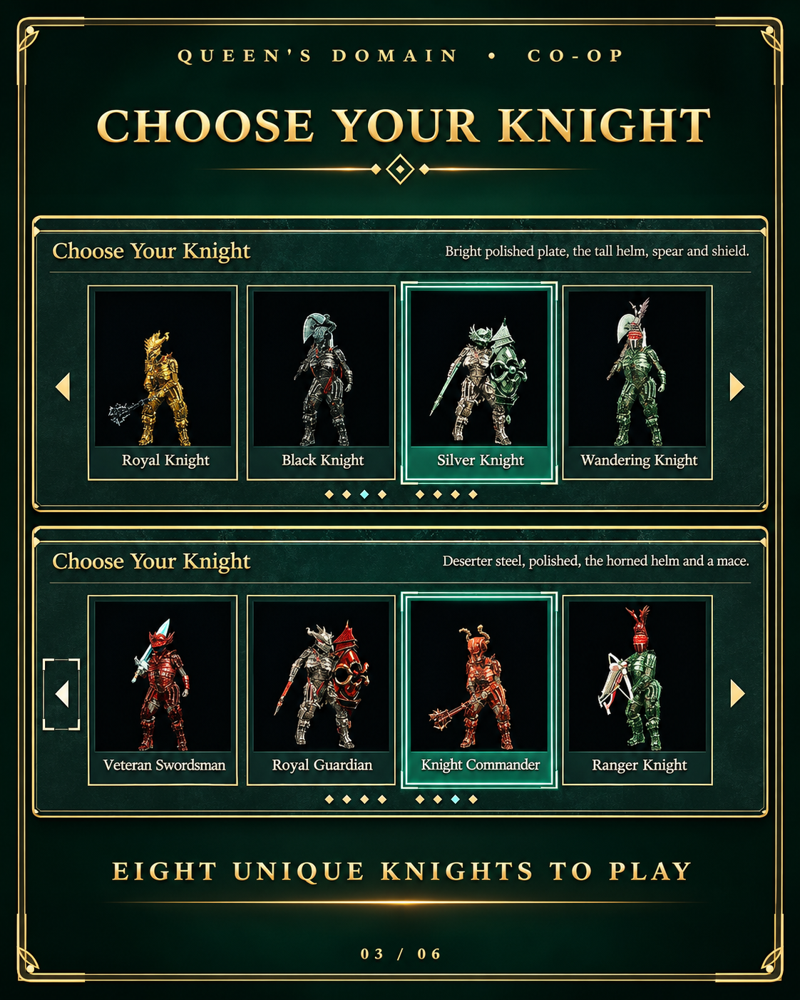
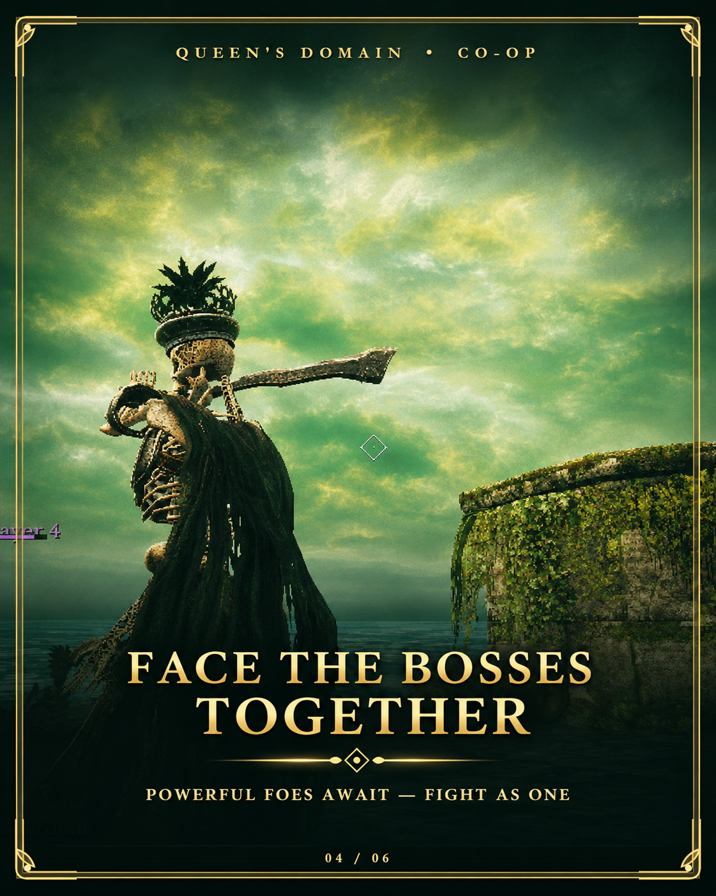
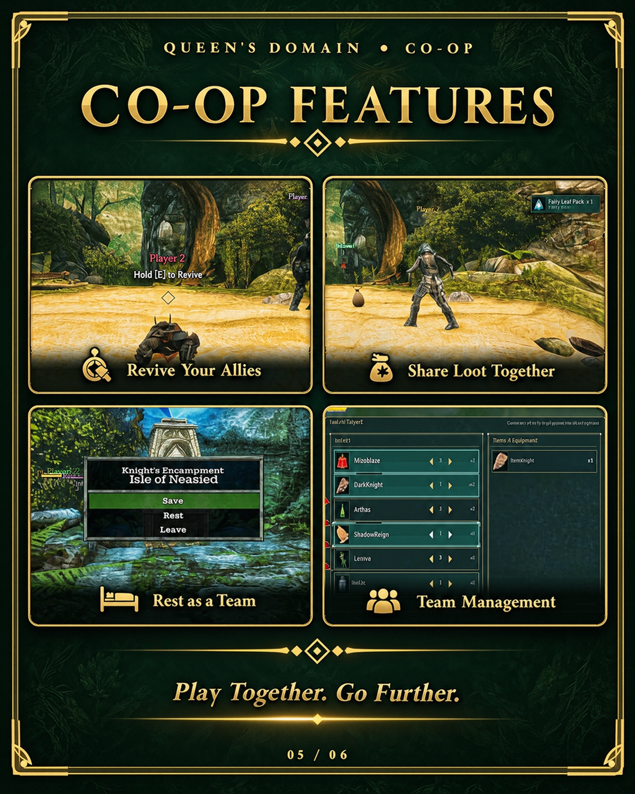
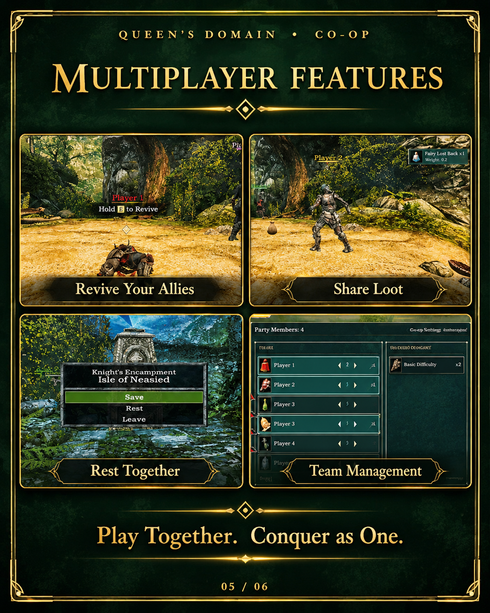
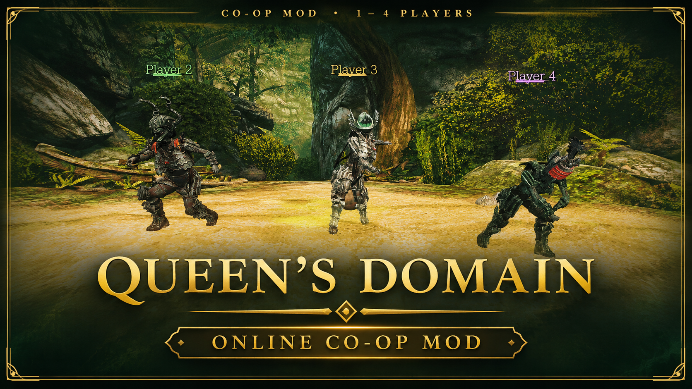

# Queen's Domain Co-op

Explore Queen's Domain together with up to three friends. Choose your knight, share the host's world, revive your allies, trade items, and rest as a party.

**[Download](https://github.com/MIZO-GAKI/QueensDomainCoop/releases/download/v0.20.2/QueensDomainCoop-0.21.0.zip)** ·

- Co-op for 1–4 players in the host's world.
- Eight knight appearances, party health bars, teammate markers, and pings.
- Revive downed allies, share important loot, and trade with teammates.
- Party checkpoint rests and saves, with co-op characters separate from solo saves.
- Difficulty presets for different party sizes, plus custom settings.
- Catch-up for joining players, including campaign items, experience, and weapon levels.
- No friendly fire; hit feedback stays on the affected player's screen.

## Install and play

Requires the Windows Steam version of Queen's Domain. Every player needs the game and the mod. The supplied documentation lists game versions 1.01.03, 1.01.05, 1.01.06a, and 1.01.07 as tested, with this mod version tested on the last two.

1. Download **QueensDomainCoop** from the release assets.
2. Close the game and extract the ZIP somewhere **outside the game folder**.
3. Copy the file to game folder.
4. Launch the game through Steam and select **Co-op** from the title screen.
5. Host a campaign or join a friend. Use **F8** or hold **View / Select** to open the in-game co-op menu.

Install the same mod version for everyone in the party. Save at a checkpoint before leaving: ending a session does not itself save progress.

### Connection and testing status

Steam invites, Steam join codes, LAN codes, and direct addresses are implemented, but the included testing report does **not** verify Steam play between two separate accounts. Direct-address and LAN-code tests were performed with multiple game copies on one PC; real multi-PC LAN, VPN, and port-forwarded internet connections still need verification. Read the [known limitations](package/QueensDomainCoop-0.20.2/README.md#known-limitations) before setting up a session.

## What's new in 0.20.2

- A teammate taking damage no longer shakes or flashes their party HUD row on your screen.
- Teammate fire, poison, and other status effects no longer trigger their overlays or sounds in your game.
- A reviving teammate stays kneeling when their revive is interrupted by a hit.
- A nearby teammate's hit no longer produces your camera shake, red flash, sound, or health-bar flicker.
- Fixes for stale teammate-body references after reloading and hit attribution after long stalls.

Version 0.20.2 is protocol-compatible with 0.20.1; update every player to receive all local-screen fixes. See the [complete version history and guide](package/QueensDomainCoop-0.20.2/README.md).

# English gallery

Promotional artwork supplied by the project team. These images present the mod's features; consult the guide above for current behavior and testing limitations.

| Online co-op | Play with friends |
|---|---|
|  |  |

| Choose your knight | Face bosses together |
|---|---|
|  |  |

| Co-op features | Multiplayer features |
|---|---|
|  |  |

## Development team

| Developer | GitHub |
|---|---|
| MIZO | [@MIZO-GAKI](https://github.com/MIZO-GAKI) |
| Old Snake | [@abdulaziz53626-hash](https://github.com/abdulaziz53626-hash) |

## Package and documentation

This repository publishes the supplied v0.20.2 distribution, installer scripts, documentation, and English promotional images. The original ZIP is available as a release asset. The mod's C++ source code was not included in that distribution.

- [Full player guide and changelog](package/QueensDomainCoop-0.20.2/README.md)
- [Included testing report](package/QueensDomainCoop-0.20.2/TESTING.md)
- [Synchronization audit](package/QueensDomainCoop-0.20.2/SYNC_AUDIT.md)
- [Third-party notices](package/QueensDomainCoop-0.20.2/THIRD_PARTY.md)
- [Package checksums](package/QueensDomainCoop-0.20.2/SHA256SUMS.txt)

The packaged binaries and documentation are preserved as supplied. Publishing checks verified package checksums and file integrity; the game was not retested for this upload.

Queen's Domain is required separately. This is an unofficial mod; the mod package does not include the game's files. See the third-party notices for bundled dependency licensing.
